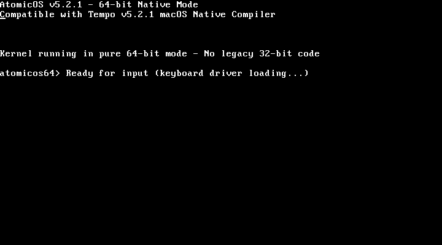

# AtomicOS

**Deterministic Real-Time Security Operating System**

[](LICENSE)
[](VERSION) [](https://github.com/ipenas-cl/AtomicOS/actions/workflows/ci.yml)

## Overview

AtomicOS is a hobby operating system written in x86-64 assembly. The long-term idea is a deterministic, real-time kernel for security-critical use, where every operation has a known worst-case execution time (WCET) and isolation is enforced by hardware.

> **Status: experimental hobby OS.** `make all` builds a bootable 64-bit image from a NASM bootloader and kernel: it boots in QEMU, switches the CPU into long mode and prints the kernel banner and prompt. Keyboard input and the shell are not wired up in this build yet. The features below are the design goals; the Tempo modules under `examples/` are the experiments behind them. Tempo later evolved into [Chronos](https://github.com/ipenas-cl/Chronos).



## Design goals

- **100% Deterministic**: Every operation has proven worst-case execution time
- **Real-Time Guarantees**: EDF and RMS schedulers with deadline enforcement
- **Security First**: 12 layers of protection, hardware-enforced isolation
- **Pure Assembly**: No high-level language overhead
- **Minimal Attack Surface**: < 10,000 lines of audited code

## Quick Start

```bash
# Clone the repository
git clone https://github.com/ipenas-cl/AtomicOS.git
cd AtomicOS

# Build the OS
make all

# Run in QEMU
make run

# Run headless (no curses window), e.g. over SSH
qemu-system-x86_64 -drive format=raw,file=build/atomicos.img -display none -serial stdio

# Debug with GDB (QEMU waits for gdb on :1234)
make debug
```

## System Requirements

- x86-64 machine or QEMU (`qemu-system-x86_64`)
- `nasm`, `make`

## Architecture

### Core Components

```
AtomicOS/
├── src/
│   ├── bootloader/     # First-stage boot (512 bytes)
│   └── kernel/         # Kernel core
│       ├── kernel.asm  # Main kernel entry
│       ├── interrupts.asm  # IDT and handlers
│       ├── *.tempo     # Security modules (compiled with Tempo)
│       └── *.inc       # Generated from Tempo modules
├── examples/           # Tempo modules for kernel
│   └── atomicos/       # Core OS modules written in Tempo
├── include/            # System headers
├── build/             # Build output
└── scripts/           # Build and utility scripts
```

### Security Architecture

1. **Hardware Isolation**: Separate memory domains
2. **W^X Protection**: No page is both writable and executable
3. **Stack Protection**: Hardware-enforced guard pages
4. **KASLR**: Kernel randomization at boot
5. **Secure Boot**: Cryptographic verification

### Real-Time Features

- **Schedulers**: EDF (dynamic) and RMS (static)
- **WCET Analysis**: Every function has proven bounds
- **Priority Inheritance**: Prevents priority inversion
- **Deadline Monitoring**: Automatic deadline violation handling

## Building

### Prerequisites

```bash
# Only nasm, make and QEMU are needed for `make all` / `make run`.
# Ubuntu/Debian
sudo apt-get install build-essential nasm qemu-system-x86

# macOS
brew install nasm qemu

# Arch Linux
sudo pacman -S base-devel nasm qemu
```

### Build Commands

```bash
make all        # Build the bootable image: build/atomicos.img
make run        # Boot it in QEMU
make clean      # Remove build output
```

## Testing

CI ([.github/workflows/ci.yml](.github/workflows/ci.yml)) builds the image on every push and boots it in QEMU as a smoke test.
The kernel unit tests under `src/tests/` depend on the old Tempo toolchain and are not wired into the Makefile yet.

## Documentation

- [Architecture Guide](docs/architecture/KERNEL_DESIGN.md)
- [Architecture overview](docs/architecture/overview.md)

## Contributing

1. Fork the repository
2. Create your feature branch (`git checkout -b feature/amazing`)
3. Check it still builds and boots (`make all && make run`)
4. Commit changes (`git commit -m 'Add feature'`)
5. Push to branch (`git push origin feature/amazing`)
6. Open a Pull Request

## Performance targets (not measured yet)

- Boot time: < 100ms
- Context switch: < 1000 cycles
- Interrupt latency: < 500 cycles
- Memory allocation: O(1) deterministic

## License

MIT License - see [LICENSE](LICENSE) file

## Author

**Ignacio Peña Sepúlveda** ([@ipenas-cl](https://github.com/ipenas-cl))

---

*"Security First, Stability Second, Performance Third"* - AtomicOS Philosophy
