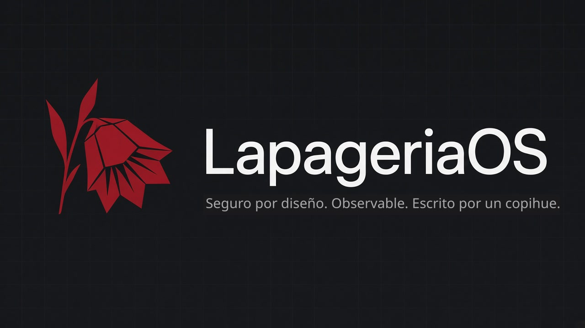

# LapageriaOS

<p align="center"></p>

Sistema operativo x86-64 seguro por diseño: privilegios mínimos, memoria protegida (NX y W^X, kernel en la mitad alta), aislamiento por zonas, trazas integradas y sistema de archivos con checksums y snapshots. El kernel y el arranque están escritos en [Copihue](https://github.com/ipenas-cl/copihue), un lenguaje propio, sin ensamblador en línea. Lapageria rosea es el nombre científico del copihue, la flor nacional de Chile. Antes se llamó AtomicOS.

[](LICENSE)
[](VERSION)
[](https://github.com/ipenas-cl/LapageriaOS/actions/workflows/ci.yml)

Versión de kernel **0.8**, en desarrollo activo. Cada cambio arranca en QEMU y pasa `make qemu-test` en CI. Lo que ya está y lo que falta de cada etapa está en la [hoja de ruta](#hoja-de-ruta).

## Qué arranca hoy

`make all` escribe `build/lapageriaos.img`, una imagen cruda de 2880 sectores de 512 bytes (1474560 bytes). No queda ningún `.asm` en esa imagen.

| LBA | Qué es | Dónde queda en memoria |
|---|---|---|
| 0 | `boot.lap`, `copihue --boot`, 512 bytes, firma `55 aa` | `0x7C00` |
| 1..8 | `stage2.lap`, `copihue --flat 0x8200` | `0x8200` |
| 9.. | kernel, `copihue --flat 0xFFFFFFFF80010000` | físico `0x10000`; VA `0xFFFFFFFF80010000` |

La etapa 1 solo carga los 8 sectores de la etapa 2. La etapa 2 habilita A20, lee el kernel con INT 13h, guarda el mapa E820 en `0x8000` y entra en modo largo. CR3 queda en `0x1000`, con PML4[0] `0x2003`, PDPT[0] `0x3003` y PD[0] `0x83` (identidad de los primeros 2 MiB). PML4[511] queda en `0x4003`, PDPT[510] en `0x5003` y la PD de `0x5000` repite esa RAM en `0xFFFFFFFF80000000`. La pila pasa a `0xFFFFFFFF80090000` (la página física `0x90000`) y el salto al kernel es `jmp rax` a `0xFFFFFFFF80010000`: un salto relativo no entra en 32 bits. El kernel, si CPUID dice que hay NX, parte las dos páginas de 2 MiB en 4 KiB, prende EFER.NXE y CR0.WP, y quita de la tabla baja las páginas de la imagen. El detalle está en [docs/nx.md](docs/nx.md) y [docs/higher-half.md](docs/higher-half.md). El número de unidad del BIOS queda en `0x0500`.

El número de sectores del kernel no está fijo en el fuente. `stage2.lap` tiene el marcador `dw 0; // KERNEL_SECTORS`. `make` copia el archivo a `build/stage2.lap` y escribe ahí `ceil(kernel.bin / 512)`. Ese número es el total. La etapa 2 lo parte en paquetes de 128 sectores: un INT 13h con offset 0 no puede pasar de 64 KiB, porque el offset es de 16 bits. Cada paquete usa el segmento `0x1000`, `0x2000`, … y el LBA que sigue. `>` en modo real ensambla `setg` (con signo); con un total de hasta 32767 el corte en 128 sigue valiendo. El tope de `make` es 512.

El archivo puede pasar de `0x20000`. La `.bss` no va en `kernel.bin`; `_start` la limpia justo después. El tope real es la memoria, no el disquete (quedan 2880 − 9 sectores, y eso atravesaría las pilas y pasaría de 1 MB). La primera pila fija está en `0x60000` (`proc_rsp0` del proceso 0) y crece hacia abajo. Entre topes de pila hay 32 KiB (`0x60000`, `0x68000`, `0x70000`, `0x78000`, y más arriba `0x81000`, `0x86000` y `0x90000`), así que imagen y `.bss` tienen que terminar antes de `0x58000`. `make` reserva 32 KiB para la `.bss` y rechaza un `kernel.bin` de más de 512 sectores (256 KiB, el archivo termina a más tardar en `0x50000`). También suma los `resb` y `resq` de la `.bss` y falla si `0x10000 + kernel.bin + .bss` pasa de `0x58000`.

En esta compilación (`copihue` v0.31.0, commit `495bb4b54d3fba77ed83aa51c0d2362ea9ebd621`, `wc -l` y `stat`):

| Archivo | Tamaño |
|---|---|
| `build/boot.bin` | 512 bytes, firma `55 aa`. El último byte distinto de cero antes de la firma está en el offset 168 |
| `build/stage2.bin` | 1789 bytes (cabe en 8 × 512) |
| `build/kernel.bin` | 157775 bytes → 309 sectores (LBA 9..317). `make` suma 22188 bytes de `.bss` y escribe fin de imagen `0x3befb`. `__bss_end` es `0xFFFFFFFF8003BEFC` (físico `0x3BEFC`) |
| `src/bootloader/boot.lap` | 70 líneas, ninguna `asm("...")` |
| `src/bootloader/stage2.lap` | 293 líneas, ninguna `asm("...")` |
| `src/kernel/copihue/*.lap` | 6265 líneas, ninguna `asm("...")`. `exec_img.lap` y `zone_img.lap` los genera `mkaxe.sh` y no entran en ese conteo. `hh.lap` son 256 de esas líneas y `nx.lap` son 678 |

`copihue --help` en v0.31.0 no tiene un `-D` ni otro modo de inyectar el conteo. Por eso lo sustituye el Makefile. El binario de la etapa 2 lleva el paquete `10 00 35 01 00 00 00 10 09 00 00 00 00 00 00 00`: 309 sectores (`0x0135`) desde LBA 9 hacia `0x1000:0`. 309 pasa de 128 dos veces, así que la etapa 2 manda 128, después 128 y al final 53. Una imagen armada aparte, con el conteo en 129 y seis sectores de cero al final, también llegó al prompt en un pin anterior: el segundo paquete no pisa el kernel. Esta corrida no repitió esa imagen. La imagen anterior, con el kernel todavía enlazado en `0x10000`, llevaba `10 00 24 01 …` (292 sectores, LBA 9..300).

El tope que aplica `make` es 512 sectores de `kernel.bin`. Sale de la memoria, no del disquete. La imagen tiene 2880 sectores; después del LBA 8 quedan 2871, y 512 caben (el kernel máximo terminaría en el LBA 520, y sobran 2359 sectores). 512 × 512 bytes terminan en `0x50000`. La reserva de 32 KiB para la `.bss` llega justo a `0x58000`, antes de la pila de `0x60000`. Esta imagen usa 309 de esos 512. `make` imprime el final `0x3befb` (`0x10000 + kernel.bin +` la suma de `resb`/`resq`). Hasta `0x58000` quedan 114949 bytes con esa cuenta. `__bss_end` físico es `0x3befc`: entre `__data_end` (`0x3684f`) y `__bss_start` (`0x36850`) hay 1 byte de alineación que esa suma no cuenta, y `0x3befc` también queda antes de `0x58000`. Si el archivo creciera hasta el tope de 512 y la `.bss` se quedara en 22188, el final de `make` sería `0x556ac`, todavía antes de `0x58000`. El otro freno es ese final: `make` falla si la suma pasa de `0x58000`, aunque el archivo quepa en 512 sectores. v0.30.0 y v0.31.0 mantienen el `push ebx` / `pop ebx` de v0.29.4 en cada comparación y en cada operador aritmético de `bits 16` y `bits 32`. Sin NX, v0.31.0 medía `kernel.bin` en 136835 bytes (268 sectores, LBA 9..276, paquete `10 00 0c 01 …`, `.bss` 22060, fin `0x36CAF`) y `stage2.bin` en 1682. La rama NX sobre v0.29.4 medía 149053 bytes y 292 sectores, con `stage2.bin` en 1678. La imagen NX de v0.31.0 todavía enlazada en `0x10000` medía los mismos 149053 bytes, `.bss` 22124, fin `0x39ca9`, `__bss_end` `0x39cac` y `stage2.bin` en 1682. En el ensamblado de esta etapa 2, el salto final es `jmp rax` (`FF E0` en el offset `0x6FA` de `stage2.bin`): `mov eax, 0xFFFFFFFF` / `shl` 32 / `or 0x80090000` a RSP, y lo mismo con `0x80010000` para el RIP. `rsp = 0x90000` queda antes, para el `push`/`pop` de ese desplazamiento. El conteo E820 es la palabra en 32768 (`0x8000`). Esta corrida volvió a leer `cr3=0x1000` con PML4 `0x2023` y PDPT `0x3023`.

Al arrancar, el kernel limpia la `.bss`, abre la consola VGA (el mismo texto sale por COM1), inicializa el asignador físico, carga su GDT e IDT, prende EFER.NXE y CR0.WP (`nx efer on`, `nx wp on`), retira la identidad de la imagen (`hh on text=0xffffffff80010000`), espera dos muestras del PIT y deja el shell `lapageria>`.

El shell responde a `help`, `echo`, `add`, `mul`, `clear`, `version`, `ticks`, `irqs`, `cr3`, `pf`, `nx`, `hh`, `pmm`, `user`, `sched`, `disk`, `fs`, `exec`, `zone`, `net`, `trace`, `ud2` y `reboot`. `nx` recorre el bit NX y W^X (ver [docs/nx.md](docs/nx.md)). `hh` comprueba que RIP y RSP están en la ventana alta, que `0x10000` ya no está presente y que un proceso de anillo 3 no lee ni escribe el kernel (ver [docs/higher-half.md](docs/higher-half.md)). `disk` ejercita el disco de datos (ver [docs/disco.md](docs/disco.md)). `fs` es el sistema de archivos copy-on-write (ver [docs/fs.md](docs/fs.md)). `exec` carga un ejecutable plano del disco (ver [docs/exec.md](docs/exec.md)). `make qemu-test` escribe los comandos con el `sendkey` del monitor de QEMU y lee COM1. Esa prueba no escribe `reboot` (reinicia la máquina) ni `clear`.


`sched` construye dos espacios de direcciones y no reutiliza el PML4 del bootloader. Cada proceso tiene su PML4, su PDPT y su PD. PD[0] apunta a la tabla baja de 4 KiB: ahí la imagen del kernel ya no está. PML4[256..511] apuntan a un solo PDPT de kernel, sin bit de usuario. Ese PDPT mapea los primeros 2 MiB en `0xFFFF800000000000` y, en el slot 510, la PD de `0x5000`, que es por donde el kernel corre en `0xFFFFFFFF80000000`. El proceso A tiene una página de usuario en `0x500000`. El proceso B no. `exit` devuelve al asignador las páginas de cada proceso y no libera el PDPT compartido. PML4[511] queda con el bit de acceso; la prueba enmascara ese bit al comparar la mitad compartida.

## Qué comprueba `make qemu-test`

Los textos exactos están en `tests/qemu_shell_test.sh`. La prueba exige:

- el PIT avanza unas 100 ticks por segundo (dos muestras al arrancar, y `ticks` sigue creciendo en el shell);
- `echo`, `add`, `mul`, `version`, `help` y un comando desconocido;
- la IRQ1 del teclado, y `cr3` del bootloader (`0x1000`, con el bit de acceso en PML4 y PDPT);
- un `#PF` de anillo 0 en `0x200000` que reserva un marco, lo pone a cero y reanuda;
- `nx`: `nx efer on` y `nx wp on` al arrancar; un fetch a datos con el bit 4 del error (`0x11`), una escritura en `.text` (`0x03`), dos procesos que mueren al ejecutar pila y datos (`0x15`) con `nx ok sched` en medio, y una auditoría `wx=0` sin páginas de 2 MiB (`leaves=981 code=37 nx=944` en esta imagen);
- `hh`: RIP y RSP en `[0xFFFFFFFF80000000, 0xFFFFFFFF80200000)`, un `#PF` de anillo 0 al leer la imagen ya retirada en `0x10000` (error 0, CR2 `0x10000`), un proceso que lee y otro que escribe `0xFFFFFFFF80010000` (errores con bits de presente y de usuario; el de escritura también el de escritura) con `hh ok sched` en medio, y la misma auditoría `wx=0`;
- el resumen E820 y el asignador (`pmm`, `pmm high`);
- `user`: el syscall imprime `user ok`, la lectura de `0x10000` desde anillo 3 produce `#PF` con `err=0x4` (la página de la imagen ya no está en la identidad; el bit de usuario queda y el de presente no), el kernel escribe `user blocked` y vuelve al shell;
- `sched`: dos PML4 distintos, la mitad alta compartida, `alias ok` dos veces, `pf-cross` de lectura y de escritura, `getpid 1` y `getpid 2`, letras `a`/`b` intercaladas, al menos un cambio por el PIT y uno por `yield`, y `exit` devolviendo todas las páginas contadas;
- `disk`: en el esclavo IDE, `ata ok`, `blk ok` y `blk corrupt detected`, en ese orden (un byte del sector de datos pisado con el driver, sin pasar por `blk`);
- `fs`: formatea, escribe `a` como `v1`, saca el snapshot `s1`, reescribe `a` como `v2`, lee `v2` en vivo y `v1` desde `s1`, hace rollback de otro archivo y un archivo de 600 bytes. Apaga QEMU, abre el mismo `build/data.img` y vuelve a leer. Después pisa un bloque de `a`: tiene que salir `fs corrupt detected` y `s1` sigue en `v1`;
- `exec`: después del `fs`, `exec plant` escribe en el disco el programa `hola` (cabecera `AXE1`), `malo` (magic malo) y `gordo` (tamaño 65535). `exec hola` imprime `desde disco` y `exec ok`. `exec noesta` imprime `exec fail 7`. `exec malo` imprime `exec bad magic`. `exec gordo` imprime `exec bad size`. `fs corrupt hola` y otro `exec hola` imprimen `exec corrupt` y no vuelven a imprimir `desde disco`;
- `ud2` imprime la excepción `#UD`;
- `zone`: después de soltar `malo` y `gordo`, planta `ztest` y crea las zonas `a` (prefijo `za`, 12 páginas) y `b` (prefijo `zb`). `zone exec a ztest` imprime `zone fs ok`, `zone fs denied`, `zone syscall denied`, `zone quota ok` y `zone escape denied`. El archivo queda como `zan`. Las dos líneas `zone mem` coinciden. `niega=1` y `fuga=1`. Ver [docs/zonas.md](docs/zonas.md);
- `net`: con `-nic none -netdev user,id=n0 -device e1000,netdev=n0`, el kernel pide ARP a `10.0.2.2` (`net arp ok`), manda ICMP echo a esa puerta (`net ping ok`) y descarta una trama cuyo largo IP no cabe en el buffer (`net drop ok`). Si QEMU no tiene esa red, el script falla al tiro y no espera el ping. Ver [docs/red.md](docs/red.md);
- `trace`: los contadores de `#PF` y de `switch` coinciden con lo que imprimió `sched` (`trace counters ok`); `exec hola` con `sys-enter` y `sys-exit` deja las syscalls de «desde disco» en orden y con pid 1 (`trace syscall ok`); apagadas, otro `exec hola` no graba (`trace off ok`); `pit` llena el anillo, cuenta perdidos y el shell sigue (`trace overflow ok`). Ver [docs/trace.md](docs/trace.md).

En QEMU 8.2.2, con el pin v0.31.0 y la imagen sin NX (red, trazas y zonas), `make qemu-test` terminó en 0. El script imprimió: ticks 100 → 200 en 935 ms, ticks 200 → 417, `keyboard IRQ count=151`, `cr3=0x1000 pml4=0x2023 pdpt=0x3023`, `e820 n=7`, `pmm free=32480 base=0x0000000000100000 end=0x0000000007fe0000`, `gdt ok`, `pmm ok, high page 0x00201000`, letras `babababababa`, `round-robin timer=29 yield=4`, `exit freed 7+6 pages, pmm back to 32473`, `trace counters ok`, `ata ok, blk ok, blk corrupt detected`, `trace syscall ok`, `trace off ok`, `exec desde disco, missing, bad magic, bad size, corrupt`, `zone fs, denied, syscall, quota mem 32473, escape`, `net arp, ping, drop`, `trace overflow ok`, `ud2 -> #UD`, y después del segundo arranque con el mismo `data.img` la línea `fs persist v2, snap v1, corrupt detected`. `version` coincidió con la palabra `Copihue`. `strings` de `kernel.bin` muestra `LapageriaOS 0.8 - kernel written in Copihue v0.31.0`. El conteo del timer y el orden de las letras dependen del tiempo; el test no los fija más allá de lo dicho arriba. `gdt ok`, el PIT, la IRQ1, el `#PF`, el `#UD`, el round-robin y la zona salen después de `lgdt(&gdtr)`, `lidt(&idtr)`, `save_context(&shell_ctx)` y `restore_context(&shell_ctx)`.

El humo de 10 segundos de ese pin (`timeout 10 qemu-system-x86_64 -drive format=raw,file=build/lapageriaos.img -display none -no-reboot -serial file:…`, sin disco de datos y sin `-cpu qemu64`) salió con código 124: el proceso seguía vivo. La serie mostró `e820 n=7`, las siete entradas, `pmm free=32480 base=0x0000000000100000 end=0x0000000007fe0000`, `gdt load`, `gdt ok`, `timer: ticks=100`, `timer: ticks=200` y `lapageria>`. Esa corrida no escribe comandos. No se probó `reboot`, `clear`, el teclado a mano en `make qemu`, TCP, UDP, AHCI, NVMe, el bit NX ni un kernel enlazado en la mitad alta.

En QEMU 8.2.2, con el pin v0.29.4, `-cpu qemu64` y la imagen NX de esa rama (red, trazas y zonas), `make qemu-test` terminó en 0. El script imprimió: ticks 100 → 200 en 1037 ms, ticks 200 → 418, `keyboard IRQ count=151`, `cr3=0x1000 pml4=0x2023 pdpt=0x3023`, `e820 n=7`, `pmm free=32480 base=0x0000000000100000 end=0x0000000007fe0000`, `ok   nx fetch=0x00000011 write=0x00000003 user=0x00000015 audit wx=0 leaves=513 code=35 nx=478`, `pmm ok, high page 0x00201000`, letras `baabaabababb`, `round-robin timer=28 yield=4`, `exit freed 7+6 pages, pmm back to 32472`, `trace counters ok`, `ata ok, blk ok, blk corrupt detected`, `trace syscall ok`, `trace off ok`, `exec desde disco, missing, bad magic, bad size, corrupt`, `zone fs, denied, syscall, quota mem 32472, escape`, `net arp, ping, drop`, `trace overflow ok`, `ud2 -> #UD`, y después del segundo arranque con el mismo `data.img` la línea `fs persist v2, snap v1, corrupt detected`. `version` coincidió con la palabra `Copihue`. El conteo del timer y el orden de las letras dependen del tiempo; el test no los fija más allá de lo dicho arriba.

El humo de 10 segundos de esa rama (`timeout 10 qemu-system-x86_64 -cpu qemu64 -drive format=raw,file=build/lapageriaos.img -display none -no-reboot -serial file:…`, sin disco de datos) salió con código 124: el proceso seguía vivo. La serie mostró `e820 n=7`, las siete entradas, `pmm free=32480 base=0x0000000000100000 end=0x0000000007fe0000`, `nx efer on`, `nx wp on` y `lapageria>`. Esa corrida no escribe comandos. No se probó `reboot`, `clear`, el teclado a mano en `make qemu`, TCP, UDP, AHCI, NVMe ni un kernel enlazado en la mitad alta.

En la imagen anterior (v0.31.0 y NX, kernel todavía enlazado en `0x10000`), tres `make qemu-test` seguidos terminaron en 0. Los tres imprimieron `ok   nx fetch=0x00000011 write=0x00000003 user=0x00000015 audit wx=0 leaves=513 code=35 nx=478`, `keyboard IRQ count=151`, `cr3=0x1000 pml4=0x2023 pdpt=0x3023`, `e820 n=7`, `pmm free=32480`, `gdt ok`, `pmm ok, high page 0x00201000`, `exit freed 7+6 pages, pmm back to 32472`, `zone fs, denied, syscall, quota mem 32472, escape`, `net arp, ping, drop`, `trace overflow ok`, `ud2 -> #UD` y `fs persist v2, snap v1, corrupt detected`. Los ticks 100 → 200 tardaron 935 ms, 934 ms y 946 ms; la muestra siguiente fue 416, 418 y 419. Las letras fueron `abbaababbaab`, `babababababa` y `abababababba`. El round-robin fue `timer=38`, `27` y `29`, las tres con `yield=4`. El humo de 10 s de esa imagen salió 124 y mostró `nx efer on`, `nx wp on` y `lapageria>`, sin la línea `hh on`.

En esta imagen (v0.31.0, NX y la mitad alta), tres `make COPIHUE=/tmp/copihue qemu-test` seguidos en QEMU 8.2.2 terminaron en 0. Los tres imprimieron `ok   nx fetch=0x00000011 write=0x00000003 user=0x00000015 audit wx=0 leaves=981 code=37 nx=944` y `ok   hh rip rsp low=#PF user wx=0 leaves=981 code=37 nx=944`. También coincidieron `keyboard IRQ count=151`, `cr3=0x1000 pml4=0x2023 pdpt=0x3023`, `e820 n=7`, `pmm free=32480`, `gdt ok`, `pmm ok, high page 0x00201000`, `exit freed 7+6 pages, pmm back to 32471`, `zone fs, denied, syscall, quota mem 32471, escape`, `net arp, ping, drop`, `trace overflow ok`, `ud2 -> #UD` y `fs persist v2, snap v1, corrupt detected`. Los ticks 100 → 200 tardaron 935 ms, 938 ms y 1035 ms; la muestra siguiente fue 415, 419 y 418. Las letras fueron `babababababa`, `abbababababa` y `babababababa`. El round-robin fue `timer=25`, `33` y `27`, las tres con `yield=4`. `strings` de `kernel.bin` muestra `LapageriaOS 0.8 - kernel written in Copihue v0.31.0`. `version` coincidió con `Copihue`. El binario de `copihue` fue el de ese commit, compilado aparte; esta sesión no corrió el `make` que clona `build/copihue`.

El humo de 10 segundos de esta imagen (`timeout 10 qemu-system-x86_64 -cpu qemu64 -drive format=raw,file=build/lapageriaos.img -display none -no-reboot -serial file:…`, sin disco de datos) salió con código 124: el proceso seguía vivo. La serie mostró `e820 n=7`, las siete entradas, `pmm free=32480 base=0x0000000000100000 end=0x0000000007fe0000`, `gdt load`, `gdt ok`, `nx efer on`, `nx wp on`, `hh on text=0xffffffff80010000`, `timer: ticks=100`, `timer: ticks=200` y `lapageria>`. Esa corrida no escribe comandos. No se probó `reboot`, `clear`, el teclado a mano en `make qemu`, TCP, UDP, AHCI ni NVMe. `get_e820` escribe el token en `ebx`, sin copia. El detalle de lo que todavía deja `ebx` modificado está en [docs/PEDIDOS_COPIHUE.md](docs/PEDIDOS_COPIHUE.md).

## Cómo compilar y probar

Hacen falta `make`, `gcc`, `git`, `nasm`, `qemu-system-x86_64` y `socat`. `nasm` lo invoca `copihue --boot` y `copihue --flat`. `ffmpeg` solo entra si se pide una captura (`tests/qemu_shell_test.sh imagen --screenshot salida.png`).

```bash
# Debian/Ubuntu
sudo apt-get install build-essential nasm qemu-system-x86 socat git

make all          # build/lapageriaos.img; la primera vez clona y compila Copihue
make qemu         # QEMU en curses. El shell lee el teclado PS/2
make qemu-test    # arranque mudo y comprobaciones por serie
make debug        # igual que qemu, esperando gdb en tcp::1234
make clean        # borra build/
make help
```

`scripts/run_lapageriaos.sh` es un atajo de `make qemu`.

La consola serie repite el texto de VGA. Con `-display none -serial stdio` se ve el registro de arranque. Las teclas de esa terminal no llegan al shell: el shell lee el controlador PS/2. Para escribir comandos a mano hace falta la pantalla de QEMU (`make qemu`). `make qemu-test` inyecta las teclas con `sendkey`.

```bash
qemu-system-x86_64 -cpu qemu64 -drive format=raw,file=build/lapageriaos.img -display none -serial stdio
```

`make qemu`, `make debug` y `make qemu-test` agregan el disco de datos. El arranque solo, como el humo de CI, no lo necesita: sin ese drive el comando `disk` imprime `ata fail 1` y vuelve al prompt.

```bash
qemu-system-x86_64 -cpu qemu64 -drive format=raw,file=build/lapageriaos.img \
    -drive file=build/data.img,format=raw,if=ide,index=1 \
    -display none -serial stdio
```

El compilador está fijado en el Makefile (`COPIHUE_COMMIT ?= v0.31.0`, commit `495bb4b54d3fba77ed83aa51c0d2362ea9ebd621`, repositorio `https://github.com/ipenas-cl/copihue.git`). `make` lo construye en `build/copihue`. Para un binario ya compilado:

```bash
make COPIHUE=/ruta/al/copihue all
```

`make debug` abre el mismo QEMU y espera un gdb en `tcp::1234`. La imagen es un binario plano, sin tabla de símbolos ELF.

CI (`.github/workflows/ci.yml`), en cada pull request: instala `nasm`, `qemu-system-x86` y `socat`, ejecuta `make all`, arranca la imagen 10 segundos con `-cpu qemu64` (el proceso tiene que seguir vivo) y ejecuta `make qemu-test`.

`scripts/pre-commit.sh` repite esas comprobaciones. `scripts/release.sh MAYOR.MENOR` ejecuta `make all` y `make qemu-test` y actualiza `VERSION` y el Makefile. No crea commits, etiquetas ni hace push.

## Estructura

```
Makefile                      all, qemu, qemu-test, debug, clean, help
VERSION                       0.8
LICENSE                       MIT
CHANGELOG.md
.github/workflows/ci.yml
src/bootloader/boot.lap       etapa 1, 512 bytes, carga la etapa 2
src/bootloader/stage2.lap     etapa 2 en 0x8200: A20, E820, modo largo, lectura del kernel
src/kernel/copihue/
  kernel.lap                  raíz: import de los módulos, _start, banner, PIT, shell
  console.lap                 texto VGA y COM1
  keyboard.lap                PS/2 en IRQ1
  idt.lap                     IDT, PIC, PIT, excepciones
  pmm.lap                     bitmap E820, alloc y free
  paging.lap                  mapas de 4 KB y #PF de demanda en anillo 0
  gdt.lap                     GDT, TSS, ltr, vuelta del #PF de anillo 3
  sched.lap                   PML4 por proceso, round-robin, write/getpid/yield/exit
  usermode.lap                iretq, syscall, programa de anillo 3
  nx.lap                      EFER.NXE, partición de las dos páginas de 2 MiB, comando nx
  hh.lap                      RIP/RSP altos, identidad retirada, comando hh
  ata.lap                     ATA PIO, canal primario, esclavo, LBA28
  blk.lap                     bloques de 512 B con CRC-32 en otro sector
  fs.lap                      archivos copy-on-write y snapshots
  exec.lap                    exec: AXE1 del disco a un PML4 nuevo
  zone.lap                    zonas: cuota, máscara, prefijo y tope de procesos
  net.lap                     e1000, ARP, IPv4 e ICMP
  trace.lap                   sondas estáticas y anillo de eventos
  shell.lap                   editor de línea y comandos
src/user/hola.lap             programa de anillo 3 que imprime «desde disco»
src/user/zona.lap             programa de prueba de la zona `a`
tests/qemu_shell_test.sh
docs/disco.md                 layout del disco de datos
docs/fs.md                    sistema de archivos copy-on-write
docs/exec.md                  ejecutable plano AXE1 y el comando exec
docs/zonas.md                 zonas, prefijo de archivos y cuota de páginas
docs/red.md                   e1000, ARP e ICMP en la red de usuario
docs/nx.md                    bit NX, W^X y el comando nx
docs/higher-half.md           mapa de la mitad alta y el comando hh
docs/PEDIDOS_COPIHUE.md       arreglos que el compilador todavía no tiene
scripts/run_lapageriaos.sh
scripts/pre-commit.sh
scripts/release.sh
scripts/mkaxe.sh              cabecera AXE1 y bytes embebidos, sin Python
docs/copihue-shell.png
```

`make` compila `src/kernel/copihue/kernel.lap`. Ese archivo importa el resto, en el orden de `COPIHUE_KERNEL_SRC`, y Copihue los junta en un solo espacio de nombres. `build/` no se versiona.

## Hoja de ruta

El estado de cada etapa es el de la imagen que arranca `make qemu-test`.

### 1. Arranque y consola — en la imagen

Dos etapas en Copihue, modo largo, kernel en Copihue, VGA y COM1, shell con los comandos de arriba. En v0.31.0, `boot.lap` y `stage2.lap` no tienen `asm()`: los segmentos, `jmp`, los stores con ancho, `lodsb`, `rep_stosd`, `cld()`, `pushfd` / `popfd` y `push` / `pop` están en el lenguaje. El lazo que parte el kernel en paquetes de 128 sectores también. `clear_df` es `cld()` antes de `lodsb` y de `rep_stosd`. `check_long_mode` sigue con `pushfd` / `popfd` para probar el bit ID. En el kernel no queda `asm()`: `save_context` guarda el marco de `sched_go` y de `enter_user`, `restore_context` vuelve al shell, y el PIT y el `#PF` usan el puntero al marco. La red, las trazas, las zonas, el sistema de archivos y `exec` tampoco agregan `asm()`. `dq page + 3` ensambla, pero las tablas tienen que quedar en la dirección física `0x1000`, fuera de esta imagen. La cuota de la zona guarda el -1 en un local de pila. El token de INT 15h vive en `ebx`: un `while`, un `if` y un `+` de `bits 16` lo restauran. Un store cuya dirección no es número, registro o `reg±disp`, y un `lgdt` / `lidt` / `invlpg` cuyo puntero no es una etiqueta, todavía lo dejan modificado; `get_e820` no usa esos casos entre el `int 0x15` y el `if (ebx == 0)`.

### 2. Interrupciones y temporizador — en la imagen

IDT de 48 entradas. Las excepciones de CPU 0–31 imprimen su nombre; `#PF` también imprime CR2. El PIC queda remapeado a los vectores 32–47. El PIT del canal 0 va a 100 Hz (`1193182/100`). El teclado usa IRQ1. La máscara del PIC maestro es `0xFC` (IRQ0 e IRQ1 abiertas). El esclavo queda enmascarado. El resto de líneas del maestro solo envía EOI. Esta etapa no incluye APIC.

### 3. Memoria virtual — parcial, en la imagen

- Mapa E820 (como mucho 16 entradas) y un bitmap de marcos de 4 KB para la RAM tipo 1 usable, desde 1 MB y hasta 128 MB.
- Tablas del bootloader: CR3 en `0x1000`, PML4, PDPT y PD. `PD[0]` arranca como la página de identidad de 2 MB. Con NX el kernel la sustituye por 512 páginas de 4 KiB.
- `map_page` y `unmap_page` crean tablas de 4 KB. El código queda sin escritura. Datos, pilas, heap y `.bss` llevan el bit 63. La auditoría del comando `nx` exige cero páginas W+X.
- Un `#PF` de anillo 0 por página no presente, con dirección por debajo de 128 MB, asigna un marco, lo mapea con NX, lo pone a cero y reanuda.
- `user` marca el bit de usuario en PML4[0] y PDPT[0] del bootloader, mapea código ejecutable en `0x400000` y pila NX en `0x401000`.
- `sched` crea dos PML4 propios. La mitad alta es un PDPT compartido. La mitad baja es privada y usa la misma tabla de 4 KiB del primer 2 MiB.
- El kernel corre en `0xFFFFFFFF80000000`. La etapa 2 salta ahí con `jmp rax` y, al final de `nx_init`, la identidad de la imagen desaparece. La mitad baja de esa imagen queda libre para el anillo 3, que no tiene el bit de usuario sobre las páginas del kernel. El detalle está en [docs/higher-half.md](docs/higher-half.md). El bit NX sigue en la imagen; ver [docs/nx.md](docs/nx.md).

### 4. Procesos y syscalls — parcial, en la imagen

`user` entra una vez en anillo 3 (`user already` a la segunda). La GDT tiene segmentos de usuario, un TSS de 104 bytes, `ltr`, `STAR`, `LSTAR`, `SFMASK` y `EFER.SCE`, más `iretq` a anillo 3 y `syscall` / `sysret`. El syscall 1 escribe un carácter. El syscall 2 escribiría `user leak` si esa lectura del kernel llegara a ejecutarse. El `#PF` de anillo 3 vuelve al shell por la pila `rsp0` (`0x86000`). El syscall de `user` usa otra pila (`0x81000`).

`sched` añade dos procesos. El PIT, cuando la interrupción viene de anillo 3, usa el `TSS.rsp0` de ese proceso. `yield` arma el mismo marco. Las llamadas son `write` (1), `getpid` (3), `yield` (4) y `exit` (5). `exit` cambia de CR3 y devuelve las páginas de ese proceso.

`exec nombre` lee un archivo AXE1 con `fs_read` (el CRC del bloque incluido), rechaza magic malo o tamaño de más, y copia el código a un PML4 nuevo del proceso 0. Lo corre el mismo planificador (`sched_go`); no se agregó `asm()`. `user` y `sched` siguen usando las funciones `naked` internas. El programa del disco es `src/user/hola.lap`.

### 5. Disco y sistema de archivos — parcial, en la imagen

El arranque sigue leyendo la etapa 2 (8 sectores) y el kernel con INT 13h, de a 128 sectores; el conteo total lo calcula `make`. Imagen y `.bss` tienen que terminar antes de `0x58000`. El kernel trae ATA PIO del esclavo primario (LBA28: identify, leer y escribir un sector, con timeout) y bloques de 512 B cuyo CRC-32 vive en el sector de al lado. Encima hay un directorio plano copy-on-write, con snapshots y rollback. El layout del disco está en [docs/disco.md](docs/disco.md) y el del sistema de archivos en [docs/fs.md](docs/fs.md). Sigue pendiente otro bus (AHCI, NVMe).

### 6. Red — parcial, en la imagen

`net` (no el arranque) habla con el e1000 de QEMU, un 82540EM. Hay
escaneo PCI por `0xCF8`/`0xCFC`, BAR0 en `0x10000000`, bus master, y
anillos DMA sacados del asignador, alineados y bajo 4 GiB. ARP de
`10.0.2.15` (pregunta y responde who-has), IPv4 con checksum e ICMP
echo. Polling del bit DD. Sin TCP ni UDP. El detalle está en
[docs/red.md](docs/red.md).

### 7. Zonas y observabilidad — parcial, en la imagen

`zone` aísla procesos con tope de páginas, máscara de syscalls (niega por defecto), prefijo de archivos y tope de procesos. La zona 0 es la global. El detalle está en [docs/zonas.md](docs/zonas.md).

`trace` tiene once sondas estáticas (syscall de entrada y de salida, cambio de contexto, `#PF`, tick del PIT, alloc y free de páginas, lectura y escritura de bloques, paquetes recibidos y enviados) y un anillo fijo de 32 eventos. Apagada, la sonda es un chequeo. El detalle está en [docs/trace.md](docs/trace.md). VGA sigue duplicada en COM1, con `ticks`, `kbd_irqs` y la línea de cada excepción.

## Historial Tempo

El lenguaje Tempo, sus compiladores, los `.s` y `.inc` generados, el `link.ld` antiguo y el binario `tools/tempo_compiler` siguen en el historial de git. El commit anterior a esa limpieza es `355f4ec7438239f0062988512a5c9f585da8cc57` (punta de `cursor/copihue-v0.23-usermode-46c5` al abrir el cambio). Ahí puede crearse la etiqueta `legacy-tempo`. Este árbol no reescribe historia ni mueve `main`.

[LICENSE](LICENSE) es MIT y conserva el aviso de marca de Tempo.

## Autor

**Ignacio Peña Sepúlveda** ([@ipenas-cl](https://github.com/ipenas-cl))
