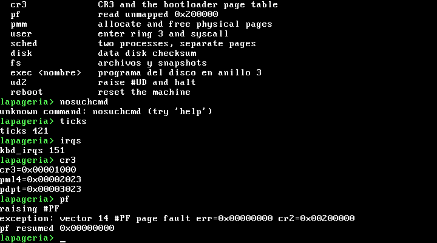

# AtomicOS

Sistema operativo de Ignacio Peña Sepúlveda. El kernel y el arranque están escritos en [Copihue](https://github.com/ipenas-cl/copihue). El nombre del sistema puede cambiar; este repositorio sigue llamándose AtomicOS.

[](LICENSE)
[](VERSION)
[](https://github.com/ipenas-cl/AtomicOS/actions/workflows/ci.yml)

Versión de kernel **0.8**. Experimental.

## Qué arranca hoy

`make all` escribe `build/atomicos.img`, una imagen cruda de 2880 sectores de 512 bytes (1474560 bytes). No queda ningún `.asm` en esa imagen.

| LBA | Qué es | Dónde queda en memoria |
|---|---|---|
| 0 | `boot.lap`, `copihue --boot`, 512 bytes, firma `55 aa` | `0x7C00` |
| 1..8 | `stage2.lap`, `copihue --flat 0x8200` | `0x8200` |
| 9.. | kernel, `copihue --flat 0x10000` | `0x10000` |

La etapa 1 solo carga los 8 sectores de la etapa 2. La etapa 2 habilita A20, lee el kernel con INT 13h, guarda el mapa E820 en `0x8000` y entra en modo largo. La pila del kernel queda en `0x90000`. CR3 queda en `0x1000`, con PML4[0] `0x2003`, PDPT[0] `0x3003` y PD[0] `0x83`. El número de unidad del BIOS queda en `0x0500`.

El número de sectores del kernel no está fijo en el fuente. `stage2.lap` tiene el marcador `dw 0; // KERNEL_SECTORS`. `make` copia el archivo a `build/stage2.lap` y escribe ahí `ceil(kernel.bin / 512)`. Ese número es el total. La etapa 2 lo parte en paquetes de 128 sectores: un INT 13h con offset 0 no puede pasar de 64 KiB, porque el offset es de 16 bits. Cada paquete usa el segmento `0x1000`, `0x2000`, … y el LBA que sigue. `>` en modo real ensambla `setg` (con signo); con un total de hasta 32767 el corte en 128 sigue valiendo. El tope de `make` es 512.

El archivo puede pasar de `0x20000`. La `.bss` no va en `kernel.bin`; `_start` la limpia justo después. El tope real es la memoria, no el disquete (quedan 2880 − 9 sectores, y eso atravesaría las pilas y pasaría de 1 MB). La primera pila fija está en `0x60000` (`proc_rsp0` del proceso 0) y crece hacia abajo. Entre topes de pila hay 32 KiB (`0x60000`, `0x68000`, `0x70000`, `0x78000`, y más arriba `0x81000`, `0x86000` y `0x90000`), así que imagen y `.bss` tienen que terminar antes de `0x58000`. `make` reserva 32 KiB para la `.bss` y rechaza un `kernel.bin` de más de 512 sectores (256 KiB, el archivo termina a más tardar en `0x50000`). También suma los `resb` y `resq` de la `.bss` y falla si `0x10000 + kernel.bin + .bss` pasa de `0x58000`.

En esta compilación (`copihue` v0.26.1, commit `54dc238f943968e676040e67bdac206ce201bc7f`, `wc -l` y `stat`):

| Archivo | Tamaño |
|---|---|
| `build/boot.bin` | 512 bytes |
| `build/stage2.bin` | 1736 bytes (cabe en 8 × 512) |
| `build/kernel.bin` | 62524 bytes → 123 sectores (LBA 9..131). La `.bss` mide 9968 bytes y `0x10000 + kernel.bin + .bss` termina en `0x21B2C` |
| `src/bootloader/boot.lap` | 76 líneas, ninguna `asm("...")` |
| `src/bootloader/stage2.lap` | 268 líneas, ninguna `asm("...")` |
| `src/kernel/copihue/*.lap` | 2947 líneas, 17 de ellas `asm("...")` |

`copihue --help` en v0.26.1 no tiene un `-D` ni otro modo de inyectar el conteo. Por eso lo sustituye el Makefile. El binario de la etapa 2 lleva el paquete `10 00 7b 00 00 00 00 10 09 00 00 00 00 00 00 00`: 123 sectores (`0x007B`) desde LBA 9 hacia `0x1000:0`. Esta imagen entra en un solo paquete. Una imagen armada aparte, con el conteo en 129 y seis sectores de cero al final, también llegó al prompt: el segundo paquete no pisa el kernel.

Al arrancar, el kernel limpia la `.bss`, abre la consola VGA (el mismo texto sale por COM1), inicializa el asignador físico, carga su GDT e IDT, espera dos muestras del PIT y deja el shell `atomicos>`.

El shell responde a `help`, `echo`, `add`, `mul`, `clear`, `version`, `ticks`, `irqs`, `cr3`, `pf`, `pmm`, `user`, `sched`, `disk`, `fs`, `ud2` y `reboot`. `disk` ejercita el disco de datos (ver [docs/disco.md](docs/disco.md)). `fs` es el sistema de archivos copy-on-write (ver [docs/fs.md](docs/fs.md)). `make qemu-test` escribe los comandos con el `sendkey` del monitor de QEMU y lee COM1. Esa prueba no escribe `reboot` (reinicia la máquina) ni `clear`.



Vídeo de unos 40 s: [docs/atomicos-copihue-demo.mp4](docs/atomicos-copihue-demo.mp4).

`sched` construye dos espacios de direcciones y no reutiliza el PML4 del bootloader. Cada proceso tiene su PML4, su PDPT y su PD. PD[0] repite la página de identidad de 2 MB de supervisor (`0x83`), porque el kernel está enlazado en `0x10000` y la etapa 2 salta ahí. PML4[256..511] apuntan a un solo PDPT de kernel, sin bit de usuario. Ese PDPT mapea los primeros 2 MB en `0xFFFF800000000000`. El proceso A tiene una página de usuario en `0x500000`. El proceso B no. `exit` devuelve al asignador las páginas de cada proceso y no libera el PDPT compartido.

## Qué comprueba `make qemu-test`

Los textos exactos están en `tests/qemu_shell_test.sh`. La prueba exige:

- el PIT avanza unas 100 ticks por segundo (dos muestras al arrancar, y `ticks` sigue creciendo en el shell);
- `echo`, `add`, `mul`, `version`, `help` y un comando desconocido;
- la IRQ1 del teclado, y `cr3` del bootloader (`0x1000`, con el bit de acceso en PML4 y PDPT);
- un `#PF` de anillo 0 en `0x200000` que reserva un marco, lo pone a cero y reanuda;
- el resumen E820 y el asignador (`pmm`, `pmm high`);
- `user`: el syscall imprime `user ok`, la lectura de `0x10000` desde anillo 3 produce `#PF` con `err=0x5`, el kernel escribe `user blocked` y vuelve al shell;
- `sched`: dos PML4 distintos, la mitad alta compartida, `alias ok` dos veces, `pf-cross` de lectura y de escritura, `getpid 1` y `getpid 2`, letras `a`/`b` intercaladas, al menos un cambio por el PIT y uno por `yield`, y `exit` devolviendo todas las páginas contadas;
- `disk`: en el esclavo IDE, `ata ok`, `blk ok` y `blk corrupt detected`, en ese orden (un byte del sector de datos pisado con el driver, sin pasar por `blk`);
- `fs`: formatea, escribe `a` como `v1`, saca el snapshot `s1`, reescribe `a` como `v2`, lee `v2` en vivo y `v1` desde `s1`, hace rollback de otro archivo y un archivo de 600 bytes. Apaga QEMU, abre el mismo `build/data.img` y vuelve a leer. Después pisa un bloque de `a`: tiene que salir `fs corrupt detected` y `s1` sigue en `v1`;
- `ud2` imprime la excepción `#UD`.

En QEMU 8.2.2, con el pin v0.26.1, una corrida de `make qemu-test` terminó en 0 e imprimió: ticks 100 → 200 en 932 ms, ticks 200 → 416, `kbd_irqs=151`, `cr3=0x1000`, `e820 n=7`, `pmm free=32480 base=0x0000000000100000 end=0x0000000007fe0000`, `pmm high ok 0x00201000`, letras `babababababa`, `switch timer=21 yield=4`, `exit` liberó 7+6 páginas y el asignador volvió a 32473, las líneas `ata ok`, `blk ok`, `blk corrupt detected`, y después del segundo arranque con el mismo `data.img` la línea `fs persist v2, snap v1, corrupt detected`. El conteo del timer y el orden de las letras dependen del tiempo; el test no los fija más allá de lo dicho arriba. `version` dice Copihue v0.26.1.

El humo de 10 segundos (`timeout 10 qemu-system-x86_64 -drive format=raw,file=build/atomicos.img -display none -no-reboot`) salió con código 124: el proceso seguía vivo.

## Cómo compilar y probar

Hacen falta `make`, `gcc`, `git`, `nasm`, `qemu-system-x86_64` y `socat`. `nasm` lo invoca `copihue --boot` y `copihue --flat`. `ffmpeg` solo entra si se pide una captura (`tests/qemu_shell_test.sh imagen --screenshot salida.png`).

```bash
# Debian/Ubuntu
sudo apt-get install build-essential nasm qemu-system-x86 socat git

make all          # build/atomicos.img; la primera vez clona y compila Copihue
make qemu         # QEMU en curses. El shell lee el teclado PS/2
make qemu-test    # arranque mudo y comprobaciones por serie
make debug        # igual que qemu, esperando gdb en tcp::1234
make clean        # borra build/
make help
```

`scripts/run_atomicos.sh` es un atajo de `make qemu`.

La consola serie repite el texto de VGA. Con `-display none -serial stdio` se ve el registro de arranque. Las teclas de esa terminal no llegan al shell: el shell lee el controlador PS/2. Para escribir comandos a mano hace falta la pantalla de QEMU (`make qemu`). `make qemu-test` inyecta las teclas con `sendkey`.

```bash
qemu-system-x86_64 -drive format=raw,file=build/atomicos.img -display none -serial stdio
```

`make qemu`, `make debug` y `make qemu-test` agregan el disco de datos. El arranque solo, como el humo de CI, no lo necesita: sin ese drive el comando `disk` imprime `ata fail 1` y vuelve al prompt.

```bash
qemu-system-x86_64 -drive format=raw,file=build/atomicos.img \
    -drive file=build/data.img,format=raw,if=ide,index=1 \
    -display none -serial stdio
```

El compilador está fijado en el Makefile (`COPIHUE_COMMIT ?= v0.26.1`, commit `54dc238f943968e676040e67bdac206ce201bc7f`, repositorio `https://github.com/ipenas-cl/copihue.git`). `make` lo construye en `build/copihue`. Para un binario ya compilado:

```bash
make COPIHUE=/ruta/al/copihue all
```

`make debug` abre el mismo QEMU y espera un gdb en `tcp::1234`. La imagen es un binario plano, sin tabla de símbolos ELF.

CI (`.github/workflows/ci.yml`), en cada pull request: instala `nasm`, `qemu-system-x86` y `socat`, ejecuta `make all`, arranca la imagen 10 segundos (el proceso tiene que seguir vivo) y ejecuta `make qemu-test`.

`scripts/pre-commit.sh` repite esas comprobaciones. `scripts/release.sh MAYOR.MENOR` ejecuta `make all` y `make qemu-test` y actualiza `VERSION` y el Makefile. No crea commits, etiquetas ni hace push.

## Estructura

```
Makefile                      all, qemu, qemu-test, debug, clean, help
VERSION                       0.8
LICENSE                       MIT
CHANGELOG.md
.github/workflows/ci.yml
src/bootloader/boot.lap       etapa 1, 512 bytes, carga la etapa 2
src/bootloader/stage2.lap     etapa 2 en 0x8200: A20, E820, modo largo, lectura del kernel
src/kernel/copihue/
  kernel.lap                  raíz: import de los módulos, _start, banner, PIT, shell
  console.lap                 texto VGA y COM1
  keyboard.lap                PS/2 en IRQ1
  idt.lap                     IDT, PIC, PIT, excepciones
  pmm.lap                     bitmap E820, alloc y free
  paging.lap                  mapas de 4 KB y #PF de demanda en anillo 0
  gdt.lap                     GDT, TSS, ltr, vuelta del #PF de anillo 3
  sched.lap                   PML4 por proceso, round-robin, write/getpid/yield/exit
  usermode.lap                iretq, syscall, programa de anillo 3
  ata.lap                     ATA PIO, canal primario, esclavo, LBA28
  blk.lap                     bloques de 512 B con CRC-32 en otro sector
  fs.lap                      archivos copy-on-write y snapshots
  shell.lap                   editor de línea y comandos
tests/qemu_shell_test.sh
docs/disco.md                 layout del disco de datos
docs/fs.md                    sistema de archivos copy-on-write
docs/PEDIDOS_COPIHUE.md       arreglos que el compilador todavía no tiene
scripts/run_atomicos.sh
scripts/pre-commit.sh
scripts/release.sh
docs/copihue-shell.png
docs/atomicos-copihue-demo.mp4
```

`make` compila `src/kernel/copihue/kernel.lap`. Ese archivo importa el resto, en el orden de `COPIHUE_KERNEL_SRC`, y Copihue los junta en un solo espacio de nombres. `build/` no se versiona.

## Hoja de ruta

El estado de cada etapa es el de la imagen que arranca `make qemu-test`.

### 1. Arranque y consola — en la imagen

Dos etapas en Copihue, modo largo, kernel en Copihue, VGA y COM1, shell con los comandos de arriba. En v0.26.1, `boot.lap` y `stage2.lap` no tienen `asm()`: los segmentos, `jmp`, los stores con ancho, `lodsb`, `rep_stosd`, `pushfd` / `popfd` y `push` / `pop` están en el lenguaje. El lazo que parte el kernel en paquetes de 128 sectores también. `cld()` sigue siendo `unknown function 'cld'`; el arranque apaga DF con `pushfd` antes de `lodsb` y de `rep_stosd`. En el kernel quedan 17 `asm()`: el salto indirecto de `resume_shell` (`jmp resume_rip` es `unknown jump target 'resume_rip'`), el marco de `enter_user` y de `sched_go` (`register 'rsp' is only available in a naked function`) y el marco de las `interrupt fn` (`register 'rbp' is only available in a naked function`). El sistema de archivos no agrega `asm()`. `dq page + 3` ensambla, pero las tablas tienen que quedar en la dirección física `0x1000`, fuera de esta imagen.

### 2. Interrupciones y temporizador — en la imagen

IDT de 48 entradas. Las excepciones de CPU 0–31 imprimen su nombre; `#PF` también imprime CR2. El PIC queda remapeado a los vectores 32–47. El PIT del canal 0 va a 100 Hz (`1193182/100`). El teclado usa IRQ1. La máscara del PIC maestro es `0xFC` (IRQ0 e IRQ1 abiertas). El esclavo queda enmascarado. El resto de líneas del maestro solo envía EOI. Esta etapa no incluye APIC.

### 3. Memoria virtual — parcial, en la imagen

- Mapa E820 (como mucho 16 entradas) y un bitmap de marcos de 4 KB para la RAM tipo 1 usable, desde 1 MB y hasta 128 MB.
- Tablas del bootloader: CR3 en `0x1000`, PML4, PDPT y PD. `PD[0]` es la página de identidad de 2 MB del kernel, de supervisor.
- `map_page` y `unmap_page` crean tablas de 4 KB por encima de esa ventana.
- Un `#PF` de anillo 0 por página no presente, con dirección por debajo de 128 MB, asigna un marco, lo mapea, lo pone a cero y reanuda.
- `user` marca el bit de usuario en PML4[0] y PDPT[0] del bootloader, mapea código en `0x400000` y pila en `0x401000`.
- `sched` crea dos PML4 propios. La mitad alta es un PDPT compartido. La mitad baja es privada.
- Sigue pendiente en esta etapa: el bit NX (`EFER.NXE` queda en claro) y ejecutar el kernel desde la mitad alta. La etapa 2 sigue saltando a `0x10000`.

### 4. Procesos y syscalls — parcial, en la imagen

`user` entra una vez en anillo 3 (`user already` a la segunda). La GDT tiene segmentos de usuario, un TSS de 104 bytes, `ltr`, `STAR`, `LSTAR`, `SFMASK` y `EFER.SCE`, más `iretq` a anillo 3 y `syscall` / `sysret`. El syscall 1 escribe un carácter. El syscall 2 escribiría `user leak` si esa lectura del kernel llegara a ejecutarse. El `#PF` de anillo 3 vuelve al shell por la pila `rsp0` (`0x86000`). El syscall de `user` usa otra pila (`0x81000`).

`sched` añade dos procesos. El PIT, cuando la interrupción viene de anillo 3, usa el `TSS.rsp0` de ese proceso. `yield` arma el mismo marco. Las llamadas son `write` (1), `getpid` (3), `yield` (4) y `exit` (5). `exit` cambia de CR3 y devuelve las páginas de ese proceso. No hay más procesos que esos dos, ni un programa de usuario que no sea una función `naked` copiada desde el kernel.

### 5. Disco y sistema de archivos — parcial, en la imagen

El arranque sigue leyendo la etapa 2 (8 sectores) y el kernel con INT 13h, de a 128 sectores; el conteo total lo calcula `make`. Imagen y `.bss` tienen que terminar antes de `0x58000`. El kernel trae ATA PIO del esclavo primario (LBA28: identify, leer y escribir un sector, con timeout) y bloques de 512 B cuyo CRC-32 vive en el sector de al lado. Encima hay un directorio plano copy-on-write, con snapshots y rollback. El layout del disco está en [docs/disco.md](docs/disco.md) y el del sistema de archivos en [docs/fs.md](docs/fs.md). Sigue pendiente otro bus (AHCI, NVMe).

### 6. Red — pendiente

El árbol que arranca no trae driver de red ni pila de protocolos.

### 7. Zonas y observabilidad — pendiente

Lo que se puede observar hoy es la consola: VGA duplicada en COM1, los contadores `ticks` y `kbd_irqs`, y la línea de cada excepción. Esta etapa cubre zonas de aislamiento y trazas; ese código todavía no está en la imagen.

## Historial Tempo

El lenguaje Tempo, sus compiladores, los `.s` y `.inc` generados, el `link.ld` antiguo y el binario `tools/tempo_compiler` siguen en el historial de git. El commit anterior a esa limpieza es `355f4ec7438239f0062988512a5c9f585da8cc57` (punta de `cursor/copihue-v0.23-usermode-46c5` al abrir el cambio). Ahí puede crearse la etiqueta `legacy-tempo`. Este árbol no reescribe historia ni mueve `main`.

[LICENSE](LICENSE) es MIT y conserva el aviso de marca de Tempo.

## Autor

**Ignacio Peña Sepúlveda** ([@ipenas-cl](https://github.com/ipenas-cl))
